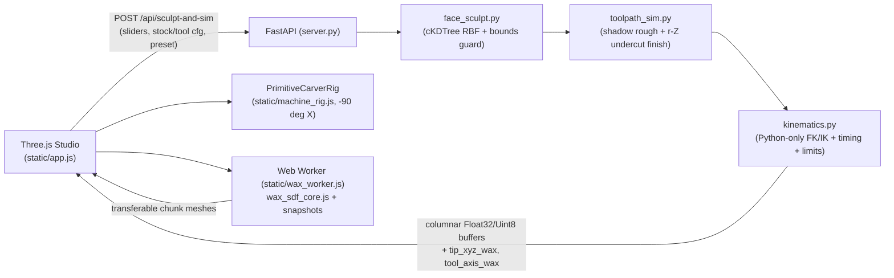

> [!NOTE]
> This document specifies **technical system architecture only** (coordinate frames, data flow, APIs, volumetric SDF state, and kinematics).
> All visual, aesthetic, and UI design decisions must be defined in `design.md`.

## Context

`carving-simulation` is a greenfield FastAPI + Three.js application reusing `load_3mf` from `mesh_formats.py` and the scientific Python stack (`numpy`, `scipy`, `trimesh`, `manifold3d`) from `wax-robot`.

## System Architecture Diagram

## Goals / Non-Goals

**Goals:**
- End-to-end simulation loop: **facial modification $\to$ synthetic 4-DOF trajectory $\to$ Web Worker volumetric undercut carving at $\ge 30\text{ FPS}$**.
- Single source of truth for FK/IK, timing, and Cartesian tip/axis vectors in Python (`kinematics.py`).
- Real undercut support via chunked 3D SDF + custom Marching Cubes (`wax_sdf_core.js` + `wax_sdf.js`).

**Non-Goals (Deferred):**
- Real controller G-code dialect emission (`G93`/`G94` `.gcode` files).
- CAD `.glb` visual skinning and physical limit-switch homing animation.
- Transient heat-transfer PDE simulation (v1 uses constant setpoint + `melt_kerf_mm`).

## Technical Decisions

### 1. Right-Handed Turntable/Wax Frame, Datums & Zero-Trig Three.js Rig
- **Frames & Rotary Collapse**: Origin `(0, 0, 0)` at center of platter top surface; `+Z` up; `theta = 0` along `+X`. Single rotary coordinate `theta = theta_ring - theta_platter` (`rad`; default single-platter `theta_ring = 0`, so `theta = -theta_platter`), making `theta_s = theta` the tool azimuth in **wax coordinates**.
- **Wrist Plane & Sign**: $\phi$ (`deg` in config/UI, `rad` in math) rotates about the local azimuthal unit vector $+\hat{e}_\theta = (-\sin\theta, \cos\theta, 0)$ by the right-hand rule: at $\phi = 0^\circ$, $\hat{u} = -\hat{e}_z$; $+\phi$ tilts inward toward $-r$ ($\hat{u}(\phi) = -\sin(\phi)\hat{e}_r - \cos(\phi)\hat{e}_z$).
- **Datums**: `r` (`mm`) from platter centerline to radial carriage datum (`x = arm_radial_offset_mm`); `h` (`mm`) from platter top to arm datum (`h2 = arm_to_pivot_z_mm`); `p = pivot_to_tip_mm` from wrist pivot axis along $\hat{u}$ to the **conical-bevel tip apex**.
- **Zero Trig in JS**: Python emits `tip_xyz_wax` and `tool_axis_wax` per frame alongside `(t, r, theta, h, phi, r_s, theta_s, z_s, v_tip, is_rapid)`. `PrimitiveCarverRig` uses a root group rotated `-90°` about `+X` (mapping machine `+Z` up to Three.js `+Y` up) and only calls `.position.set(...)` / `.rotation.set(...)`.

### 2. Chunked Volumetric SDF + Custom Marching Cubes (`wax_sdf_core.js` & `wax_worker.js`)
- **Pure Core Split**: `static/wax_sdf_core.js` has zero DOM/Three.js imports so `node --test tests/test_wax_sdf.mjs` runs directly in Node; `static/wax_sdf.js` wraps it for Three.js `BufferGeometry` upload, and `static/wax_worker.js` runs subtraction + remeshing off the main thread with transferable `Float32Array` buffers.
- **Stock Defaults & Exact Cylinder SDF**: Default `R_stock = 40.0 mm`, `H_stock = 120.0 mm`, `z_plinth_mm = 10.0 mm`. Grid bounds are padded by `>= 2` voxels outside `[-R_stock, +R_stock]` and `[0, H_stock]` so MC closes all exterior faces. Initialized via exact Euclidean cylinder SDF:
  $$d_r = r - R_{\text{stock}},\quad d_z = |z - H_{\text{stock}}/2| - H_{\text{stock}}/2,\quad \text{sdf}_{\text{cyl}} = \min(\max(d_r, d_z), 0) + \sqrt{\max(d_r, 0)^2 + \max(d_z, 0)^2}$$
  After CSG subtractions `max(sdf, -d_tool)`, the field is a **signed distance bound** (not exact Eikonal), valid for `sdf = 0` MC extraction and `sdf < -0.5 * voxel_size` collision checks.
- **Resolution, Memory & Aprons**: `128³` float32 (`8 MiB` grid, `~0.7–1.0 mm` voxel spacing; `160³` optional) partitioned into `16³` chunks (`512` chunks). Each chunk's custom Marching Cubes pass reads a **1-voxel apron** from neighbors, computes normals via global central-difference SDF gradients, and marks adjacent neighbor chunks dirty whenever boundary voxels change—eliminating seams. Note: features narrower than ~2 voxels (`~1.5 mm`) blur at `128³`, an accepted v1 interactive FPS trade-off.
- **Scrub Snapshots**: The Worker stores periodic `8 MiB` SDF snapshots (e.g. every 10% of frames); backward/forward scrubbing updates the rig immediately and restores/replays from the nearest preceding snapshot asynchronously.

### 3. Engaged-Length Distance Sampling, Timing & Collisions
- **Tool Profile**: Axisymmetric conical-bevel (`tip_radius_mm`, `cone_half_angle_deg`, `engaged_length_mm`, `melt_kerf_mm`) + unheated shank (`shank_radius_mm`, `shank_length_mm`).
- **Timing & Sampling**: `kinematics.py` computes $\Delta t = \max(\Delta s / \text{feed}, \max_i |\Delta q_i| / v_{\text{max}, i})$ from `feed_cut_mm_s`, `feed_rapid_mm_s`, and per-axis `v_max`. `toolpath_sim.py` resamples so max displacement of any point on the engaged cone $L_{\text{tip}}$ is $\le 0.5 \cdot \text{tip\_width}$.
- **Diagnostics**: `SOFT_LIMIT_EXCEEDED` (error), `PHI_POLICY_CLAMPED` (info), `SINGULARITY_HIGH_THETA_DOT` (warning when $r_s < r_{s,\min}$ and $|\dot{\theta}_s| > \dot{\theta}_{\text{warn}}$), `UNREACHABLE_UNDERCUT_AREA` (warning), `GOUGE` (warning/error), `RAPID_COLLISION` (tip+shank vs current SDF during `is_rapid`), and `SHANK_COLLISION` (unheated shank vs current SDF during cut).

### 4. API Contract (`server.py`)
- `GET /api/health` and `POST /api/sculpt-and-sim` (`{ sliders, stock_cfg, tool_cfg, preset: "demo" | "standard" }`).
- Returns sculpted mesh buffers, config, diagnostics, and **columnar base64 `Float32Array` / `Uint8Array` trajectory arrays** capped at `max_frames = 250_000` (avoiding 40–100+ MB JSON overhead).

## Risks / Trade-offs

- **[Risk] Marching Cubes chunk remeshing drops below 30 FPS on dense grids** $\to$ Mitigation: run subtraction + MC in `wax_worker.js` with transferable buffers, `16³` dirty chunks, and execute a benchmark spike before UI integration.
- **[Risk] `pivot_to_tip_mm` differs from `0.5 * S` on real hardware** $\to$ Mitigation: isolate all dimensions in `machine_config.json` and provide a measured-pose calibration test harness (`±1.0 mm` fixture pending hardware measurement).
