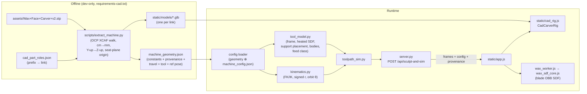

> [!NOTE]
> This document specifies **technical system architecture only** (data flow, storage, APIs, concurrency, state synchronization, and security).
> All visual, aesthetic, and UI design decisions (colors, typography, component styling, responsive layout) must be defined in `design.md`.

## Context

`carver-sim-mvp` modelled a machine from assumed dimensions: a rotating platter, a cone tip, p = 30, and a 45 mm radial offset. The owner's Fusion export (`assets/Wax+Face+Carver+v2.stp`, 295 leaf occurrences, cm units, Y-up, flat assembly) shows a different machine. Every fact used below is in research.md → Verified facts. Assumptions that are not yet verified are called out where they are used.

This change runs on top of `carver-sim-mvp` merged to `main` on 2026-11-19 as squash commit `98ac91d` (PR #1). The MVP code on `main` (`kinematics.py`, `toolpath_sim.py`, `server.py`, `static/wax_*`) is the baseline, and includes cone-based undercut finishing (`build_finishing` plus PATCH-10c helpers) with `test_finishing_follows_planar_contours` marked `expectedFailure`. This change replaces that cone geometry rather than adding finishing from scratch.

The people involved are the owner (CAD author, hardware) and implementation agents dispatched per change.

## System Architecture Diagram

## Goals / Non-Goals

**Goals:**
- Make the CAD the single source of machine geometry, through a reproducible, provenance-carrying extraction.
- Correct the kinematic datums (orbit θ, signed r to the pivot, h to the pivot, p = 60, x = 0) without changing the FK equations' form.
- Replace the axisymmetric cone with the real blade everywhere tool geometry is used: SDF stamp, CL placement, reachability, collisions, sampling.
- Render the real machine, with the ring orbiting and the wax static.

**Non-Goals:**
- Redesigning undercut finishing strategy for the blade (follow-up change). This change only swaps the geometry primitives under the existing strategy.
- Machine self-collision (arm vs column, head vs bracket across φ, ring vs stop block).
- Using `Cold_Tool_6mm_Shank`, `Block_Fixture_PLA` or the rectangular wax placeholder in simulation.
- Deciding the home pose, the stock cylinder dimensions, or the T12-K heated length. These stay config-driven, with explicit `null`s.
- G-code / controller output.

## Technical Decisions

### 1. Offline extraction, committed derived artifacts
`scripts/extract_machine.py` uses `cadquery-ocp==8.0.1.1.0` (`STEPCAFControl_Reader` with names, `XCAFDoc_ShapeTool` walk via `TDF_ChildIterator`, `xstep.cascade.unit = MM`). It writes `machine_geometry.json` (sorted keys, values rounded to 1e-4 mm) and per-link GLBs.

- **Why not parse the STEP at server start?** OCP is roughly 100 MB of native wheels. It would make server start depend on CAD parsing (seconds) and pull an LGPL native stack into the runtime.
- **Why not use the STL?** It's a nameless soup, so links can't be separated.

The cost is that CAD revisions need a re-run. `step_sha256` in the JSON, together with a test comparing it to the committed STEP's hash, catches stale artifacts.

### 2. Link roles by explicit prefix rules, not geometry inference
The Fusion export is flat: every part is a top-level occurrence, so the assembly tree carries no link meaning. `cad_part_roles.json` holds ordered `{prefix, link}` rules. An initial draft:

| Link | Parts |
| :--- | :--- |
| `static` | `Base_Plate`, `Pedestal`, `Drip_Plate`, `Leveling_Mount`, `Turntable_Static_Race`, `Wear_Strip`, `Track_Guard`, `Stop_Block`, `Stop_Bumpers`, `Orbit_Limit_Switches`, `Orbit_Motor`, `Orbit_Pulley`, `Orbit_Belt_GT2_9mm:` (motor loop), `Block_Fixture` |
| `orbit` | `Platform_Ring`, `Turntable_Carrier`, `Turntable_Cage`, `Ball_Transfer`, `Orbit_Belt_GT2_9mm_OnDrum`, `Arm_Piece`, `Counterweight`, `CW_Plate`, `Z_Rod`, `Z_LeadScrew`, `Z_Motor`, `Z_Coupler`, `Z_Thrust`, `Z_Brace`, `Column_Top_Block`, `Z_Top_Stops`, `Z_Home_Switch`, `Z_Bottom_Switch` |
| `z` | `Z_Carriage`, `Z_Nut`, `Z_Bushing`, `Z_Spacer`, `Shaft_Collar`, `Arm_Extrusion`, `Radial_Rail`, `Radial_Motor`, `Radial_Pulley`, `Radial_Idler`, `Radial_Belt`, `Radial_Stop`, `HW_Zcarriage` |
| `radial` | `Radial_Carriage`, `Tilt_Bracket`, `Tilt_Servo`, `Belt_Anchor`, `Belt_Clamp` |
| `tilt` | `Servo_Horn`, `HW_Tilt`, `Tip_Holder`, `T12_K_Cartridge`, `T12_Socket` |
| `stock_placeholder` | `Wax_Block_Cast` |
| `unassigned` | `Cold_Tool_6mm_Shank`, `Dowel_3x37`, plus anything unmatched |

`FST_*` fasteners get rules by proximity group in the draft file, and are otherwise `unassigned`. The draft is a reviewable artifact (owner sign-off is a task). Inferring roles from geometry (contact graphs) was rejected: it's fragile, and wrong silently instead of loudly.

### 3. Frame and datums
- **CAD → machine transform:** `(x, y, z) → (x, −z, y − seat_y_cad)`, a proper rotation (+90° about X) plus translation. `seat_y_cad = 3.0` comes from the placeholder's bottom face. That's an assumption: the real cylinder's seat is unverified.
- **Origin:** on the orbit axis at the seat plane. Moving it from the "platter top" costs nothing, because the MVP's `z = 0` already meant "bottom of stock".
- **h:** pivot height, so `h2 = 0`. `x = pivot_radial_offset_mm` (0.0 measured). Keeping the `x`/`h2` terms in FK costs nothing, and they absorb the Dowel-pivot alternative (x = 14) if that turns out to be right.
- **Signed r:** CAD stops give carriage travel [−51, 135]. Signed r lets the IK reach the far side without orbiting through the stop block. The orbit stop angle remains unknown until extracted. The IK chooses between (r, θ) and (−r, θ + π) by explicit configured θ-limit feasibility, then by minimum |Δθ|. If extraction returns a null θ limit, config must supply a conservative limit labeled unverified; otherwise config validation blocks toolpath generation. The ±170° IK example is a synthetic test fixture, not a CAD claim.
- **`v_max_theta_rad_s` default lowered to 1.0** (from 6.0). The ring carries the column, arm and a counterweight, and 6 rad/s is about 57 rpm. This is a conservative placeholder until measured, not a CAD fact.

### 4. `tool_model.py` as the single runtime tool definition
- **Frame:** a_w = e_θ(θ), a_n = a_w × u, u from FK. The ordered frame `(a_n, a_w, u)` is right-handed; at φ = 0, a_n = −e_r. The blade thickness axis is unoriented, so this matches the CAD's X axis. Nothing spins the blade, so the frame is a pure function of (θ, φ). There's no extra state and no extra columnar buffer: the worker rebuilds it from `theta_s` and `tool_axis_wax`.
- **Heated SDF:** exact box SDF minus kerf (a rounded box). It's evaluated in Python (collision probes, tests) and mirrored in `wax_sdf_core.js`. Both read constants from the same JSON, and a cross-language parity test (1e-5 mm) pins them together. This replaces the frustum SDF at the same cost order (a few FLOPs per voxel).
- **CC→CL via support function:** for a convex body, tangency at cc with normal n means the support point s(−n) lies at cc. For a box centred at c (which is `heated_length/2` along −u from the reference point), s₀(−n) = c − Σ hᵢ·sign(n·aᵢ)·aᵢ, with ties at sign = 0 resolved to the face centroid. The same formula covers the inflated box, because inflation adds kerf·n. That gives one exact formula instead of per-tool special cases. Alternative considered: keep `cc + (ρ + kerf)·n`. Rejected because it's wrong by up to 3 mm (the blade half-width) on tangential normals.
- **Reachability by collision search over φ** instead of the closed-form cone bound. A prism has no α, and the real constraint is the shaft/head envelope. It costs roughly 1 to 28 φ candidates per contact point, each one a body-sample batch (vectorised trimesh `signed_distance` call). Mitigation: candidates are ordered from φ_ideal and stop at the first clear one. Typical cost is 1 to 3.
- **Body sampling:** rings at ≤ 0.5 mm axial pitch and ≤ 30° around, on the shaft (r 2.5), body (r 3.5) and head envelope. The reference point is the tool-local origin and axial distances are along −u; the head hull is serialized with dimensions and pose relative to that origin so Python and JS sample the same body. Sign conventions are stated explicitly: trimesh `signed_distance` is inside-positive, the wax SDF is inside-negative. This exact mix-up cost two PATCH-10 rounds.

### 5. Viewer rig
`CadCarverRig` builds `static ⊃ orbit ⊃ z ⊃ radial ⊃ tilt` groups. The GLBs are authored at `cad_reference_pose`, so each joint applies a delta from that pose. The tilt group gets a pre-baked pivot (translate to the pivot, rotate, translate back) using `machine_geometry.json.pivot_point`. It is still zero-trig: only `rotation.set` / `position.set`. GLB loading uses Three's `GLTFLoader` from the same pinned CDN version the app already uses. If loading fails, a tool-plus-wax-only scene keeps the simulator usable.

### 6. API and config merge
The config loader merges `machine_geometry.json` (geometry, travel, tool) under `machine_config.json`. The config may narrow limits but never widen them past CAD travel, and it may not override blade dimensions. `tool_cfg` accepts `melt_kerf_mm` and `heated_length_mm`. Removed cone keys return 422, so stale clients fail loudly. The response's `config.geometry_provenance` carries `step_sha256`, `ocp_version`, the `unassigned_parts` names and `home_pose: null`.

## Risks / Trade-offs

- **[Risk] Tilt pivot is actually `Dowel_3x37` (14 mm offset)** → FK keeps the `x` term. The extractor records both candidate axes, and an owner-confirmation task gates the merge. If the dowel is the pivot, it's a one-line roles/geometry change plus regenerated JSON. No code change.
- **[Risk] Link-role draft is wrong for some parts** → Parts render in the wrong place when joints move. Mitigations: owner review task, a viewer test that sweeps each joint and checks that the tilt-link cartridge tip stays on `tip_xyz_wax`, and `unassigned` reporting.
- **[Risk] φ candidate search slows finishing** → Early exit ordered from φ_ideal, a vectorised body probe, and a frame/time budget asserted in tests. Compare demo toolpath-generation time only against the `98ac91d` MVP baseline with the same enabled stages, preset, slider values, and environment.
- **[Risk] Heated length ≠ blade length** → `heated_length_mm` is configurable and limited to ≤ `blade_length_mm`. The research assumption is recorded.
- **[Risk] Stale artifacts after a CAD revision** → A test asserts `machine_geometry.json.step_sha256` equals the SHA-256 of the committed STEP.
- **[Risk] 8 MiB of GLBs in git without LFS** → Per-link tessellation tolerance (coarse for static/orbit, 0.02 mm for the cartridge) and a size-budget test. The STL is git-ignored.
- **[Trade-off] Broadside feed is reported, not prevented** → Roughing is restructured to slice. Finishing strategy changes belong to the follow-up undercut change, and the diagnostic quantifies the gap.

## Migration & Rollback Plan

1. ~~Land `carver-sim-mvp` on `main`~~ Done: squash commit `98ac91d` (2026-11-19), with cone finishing and one `expectedFailure`.
2. Branch `feat/machine-cad-integration` from `main`.
3. Commit the STEP and `.gitignore` the STL.
4. Add the extractor, roles and generated artifacts (no runtime effect yet).
5. Switch the config loader, `kinematics.py` and `tool_model.py`. Then `toolpath_sim.py`, the worker and the rig.
6. Update MVP tests whose fixtures encode p = 30, the cone or `r ≥ 0`. Each such edit is listed in `patch.md` with the reason.
7. **Rollback:** revert the branch merge. The artifacts are additive, and the only destructive edits (cone keys, `machine_rig.js`) are restored by the revert. There's no data migration, since the API is stateless.
