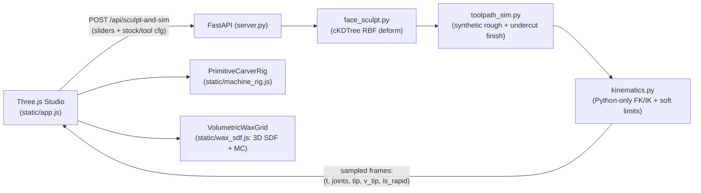

> [!NOTE]
> This document specifies **technical system architecture only** (coordinate frames, data flow, APIs, volumetric SDF state, and kinematics).
> All visual, aesthetic, and UI design decisions must be defined in `design.md`.

## Context

`carving-simulation` is a greenfield FastAPI + Three.js application reusing `mesh_formats.py` and the scientific Python stack (`numpy`, `scipy`, `trimesh`, `manifold3d`) from `wax-robot`.

## System Architecture Diagram

## Goals / Non-Goals

**Goals:**
- End-to-end simulation loop: **facial modification $\to$ synthetic 4-DOF trajectory $\to$ volumetric undercut carving at interactive FPS**.
- Single source of truth for FK/IK in Python (`kinematics.py`).
- Real undercut support via chunked 3D SDF + Marching Cubes (`VolumetricWaxGrid`).

**Non-Goals (Deferred):**
- Real controller G-code dialect emission (`G93`/`G94` `.gcode` files).
- CAD `.glb` visual skinning and physical limit-switch homing animation.
- Transient heat-transfer PDE simulation (v1 uses constant setpoint + `melt_kerf_mm`).

## Technical Decisions

### 1. Right-Handed Turntable Frame & Wrist Plane
- Origin `(0, 0, 0)` at center of platter top; `+Z` up; `theta = 0` along `+X`.
- `phi = 0` points the conical-bevel iron down (`-Z`); `+phi` tilts the tip inward toward `-r` in the `r–Z` plane.
- Python computes both joint poses `(r, theta, h, phi)` and tip poses `(r_s, theta_s, z_s)` so Three.js only applies transforms.

### 2. Chunked Volumetric SDF + Marching Cubes (`wax_sdf.js`)
- A 2.5D cylindrical heightfield cannot represent overhangs beneath the nose, brow, or chin.
- `VolumetricWaxGrid` allocates a 3D float32 SDF grid (default `128×128×128`, partitioned into `16³` dirty chunks) initialized to the cylinder $\max(r - R_{\text{stock}}, |z - H/2| - H/2)$.
- Subtracting a distance-sampled conical-bevel + `melt_kerf_mm` capsule updates only touched voxels and marks their chunks dirty for incremental Marching Cubes remeshing.

### 3. Distance-Sampled Swept Subtraction & Current-Stock Collisions
- Trajectory points are resampled in `toolpath_sim.py` so $\Delta s_{\text{tip}} \le 0.5 \cdot \text{tip\_width}$.
- `is_rapid` moves query the *current* SDF state before advancing, raising `RAPID_COLLISION` only if uncarved wax (`sdf < -tol`) is entered.

## Risks / Trade-offs

- **[Risk] Marching Cubes chunk remeshing drops below 30 FPS on dense grids** $\to$ Mitigation: keep grid configurable (`96³`–`128³`), update only dirty `16³` chunks, and decouple simulation substeps from render frames.
- **[Risk] `pivot_to_tip_mm` differs from `0.5 * S` on real hardware** $\to$ Mitigation: isolate all dimensions in `machine_config.json` and provide a measured-pose calibration test harness.
