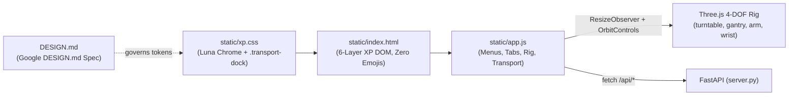

> [!NOTE]
> Technical architecture for the `luna-ui-rework` UI migration from `wax-robot` to `carving-simulation`.

## Context

Ports the Windows XP Luna Retro Minimalist shell (`wax-robot/static/xp.css`, `index.html`, `viewer.js`) into `carving-simulation/static/`, formalizes the design system in a Google `DESIGN.md` (`github.com/google-labs-code/design.md`), and wires the 4-DOF Three.js rig and `.transport-dock` to `server.py`.

## System Architecture Diagram

## Technical Decisions

### 1. Google `DESIGN.md` Compliance
- Root `DESIGN.md` and `openspec/changes/luna-ui-rework/design.md` follow `github.com/google-labs-code/design.md` (`YAML` front matter with `{colors.*}` token references + the 8 ordered `##` sections).
- Zero Unicode emojis in HTML, CSS `content:`, or JS strings (enforced by automated lint test).

### 2. 6-Layer XP DOM & Transport Dock
- `div.desktop` $\to$ `main.window#studio-window` $\to$ `div.titlebar`, `nav.menu-bar`, `div.window-body` (`aside.sidebar` + `section.viewport-shell`), `footer.status-bar`, `div.xp-dialog#help-dialog`.
- `.transport-dock` is absolutely positioned at the bottom of `.inset-well.viewport-well` (`z-index: 10`), keeping the 3D canvas full-bleed inside the recessed well.

### 3. Responsive Viewport & 4-DOF Rig
- `ResizeObserver` on `#viewport` replaces `window.resize` alone so sidebar collapse/window maximize immediately resizes `WebGLRenderer`.
- `updateRig(thetaRad, rMm, hMm, phiRad)` drives `turntableGroup`, `gantryGroup`, `radialArmGroup`, and `wristGroup` directly.

## Risks / Trade-offs

- **[Risk] Emoji regression in button/icon copy** $\to$ Mitigation: `tests/test_luna_ui.mjs` scans `static/index.html`, `static/xp.css`, and `static/app.js` for Unicode emoji ranges and fails on any match.
