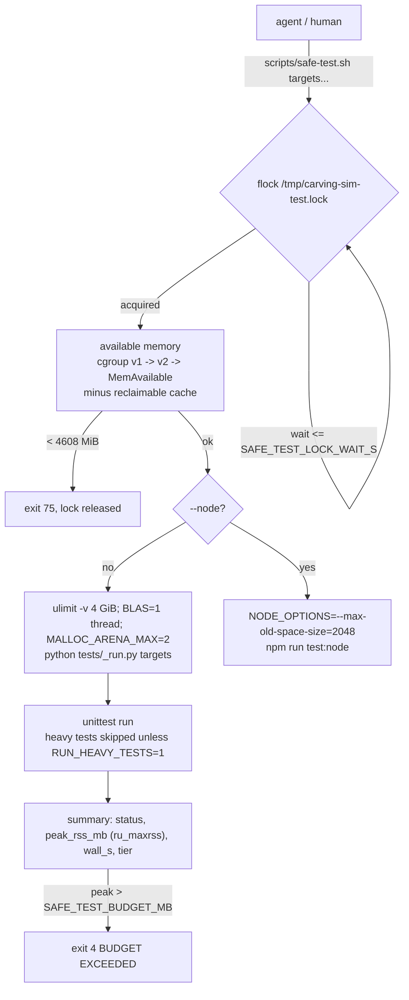

> [!NOTE]
> This document specifies **technical system architecture only** (data flow, storage, APIs, concurrency, state synchronization, and security).
> All visual, aesthetic, and UI design decisions (colors, typography, component styling, responsive layout) must be defined in `design.md`.

## Context

The suite is plain `unittest` (no pytest). It runs in a shared Docker container: cgroup v1, 12 GiB limit, 3 vCPU. Several agents (Claude Code, OpenCode workers in `~/.local/share/opencode/worktree/*`) and other projects' Playwright runs share it. Measured (research.md): the default command does about 12 **full generations**. Sculpted base_head `demo` alone peaks at about 3.5 GB, the `standard` that follows it was OOM-killed, and class fixtures are never freed. The existing guard is dead code.

The fix sits at three layers, and each one stops a different failure:

1. **Scope** (the main fix): the default tier stops doing full generations.
2. **Budget** (regression guard): the runner measures peak RSS and fails the run when it's over.
3. **Containment** (backstop): a lock queues runs; a memory check and an address-space cap turn a runaway into a failed test instead of a container-wide OOM.

## System Architecture Diagram

## Goals / Non-Goals

**Goals:**
- Default tier: peak RSS ≤ 1.5 GiB and ≤ 10 min, with no full generations.
- Two concurrent test runs (any worktrees) can't overlap.
- A runaway test fails itself, not the container.
- Each dropped assertion stays covered by a heavy-tier test or an equivalent default-tier check on a fixture.
- Identify which phase causes the base_head 3.5 GB peak.

**Non-Goals:**
- Changing `ToolpathResult.frames` to a columnar representation (see research.md, "Raised but not acted on").
- Making full generation faster (the async job API and performance work are a separate follow-up).
- Parallel test execution.
- Changing Node test content (the worker tests are already small); Node only gets the lock.

## Technical Decisions

### D1. Tier by skip decorator, not by separate directories
`tests/_tiers.py` exports `heavy = unittest.skipUnless(os.environ.get("RUN_HEAVY_TESTS") == "1", "heavy test: set RUN_HEAVY_TESTS=1")`. It's applied at method or class level, next to the default-tier rewrite, so the full-scale and small-fixture versions of an assertion sit side by side.
*Alternative:* `tests/heavy/` plus a separate discover root. Rejected because it splits related assertions across files and changes module paths in existing reports.

### D2. Default-tier rewrites per test family

| Test family (today) | Default tier after this change | Heavy tier |
|---|---|---|
| `TestSyntheticToolpaths` (sculpted base_head `demo` in `setUpClass`) | Same assertions on a **short-stock fixture**: `stock.H_stock_mm = 40`, target = base_head scaled and seated to fit the stock (`load_config(target_mesh=None)` plus override); one generation per class | A copy of the class on the real target, `@heavy` |
| `test_standard_preset_produces_denser_path` | Compare `demo` and `standard` frame counts on the short-stock fixture | The real-target version, `@heavy` |
| `TestHead2Target.setUpClass` (`head_2` `demo`) | Geometry, landmark and slider tests need only the mesh, so `setUpClass` stops generating; the path assertions use the short-stock fixture | Path-level head_2 assertions (expected warnings), `@heavy` |
| `TestSimulationAPI.test_sculpt_and_sim_columnar_contract`, `TestPatch10APIRegressions.test_demo_response_carries_geometry_provenance` | Patch `toolpath_sim.generate_synthetic_carve_path` with a small real `ToolpathResult` (about 50 frames from `kinematics.build_trajectory`, reusing `TestCollisionLogAPI._stub`'s pattern). Provenance comes from config, so no real path is needed. | One end-to-end real `demo` POST, `@heavy` |
| `test_max_frames_exceedance_maps_to_422` (600 mm stock through the API) | Patch `kinematics.load_config` (or use the request's `stock_cfg`) with `api.max_frames = 500`; with D4 this raises after a bounded amount of resampling | — |
| `TestPatch10ToolpathRegressions` (three `_FakeNeedle` `demo` generations, 67–76 s each) | The two that share `self.config` share one `cls.needle_result`; the 600 mm-stock test keeps its own generation (it hits the early `error` return before resampling, at 6.6 s measured). The needle stays default tier because it's a small fixture. | — |

The short-stock fixture lives in `tests/_fixtures.py` as `short_stock_config()` and `short_stock_target(config, sliders)`. They're plain functions, not a shared module-level cache: a process-wide cache would bring back the "never freed" problem.

### D3. `tearDownClass` frees class fixtures
A small mixin, `ReleasesClassFixtures`, in `tests/_tiers.py`: subclasses list `_class_fixtures = ("result", "mesh", "sculpt", "client", ...)`, and `tearDownClass` `delattr`s each one and calls `gc.collect()`. A mixin rather than hand-written `tearDownClass` in about 15 classes, so a new class can't forget it. The test for it uses `weakref`.

### D4. Frame-cap fail-early inside `resample_path`
`resample_path(..., max_frames: int | None = None)` checks `len(out_joints)` after each input segment and raises `FrameCapExceededError(estimate, max_frames)` once it's over. `frames` in the error is the count at the point of abort (a lower bound), and the message says "at least". Overshoot is limited to one segment's subdivision (at most `2**11` pieces at depth 11). `generate_synthetic_carve_path` passes `api.max_frames` and keeps its post-check as a belt-and-braces assertion.
*Alternative:* estimate the count from sweep lengths before resampling. Rejected because it's approximate and adds a second source of truth.

### D5. The runner is a bash script around a Python entry point
`scripts/safe-test.sh` owns the lock, the memory check, `ulimit` and the environment. The Python half, `tests/_run.py` (about 40 lines), converts targets (`tests/x.py` → `x`, dotted names pass through), runs `unittest` with `-s tests` semantics, then prints `ru_maxrss` and wall time and returns status 4 on a budget overrun. `ru_maxrss` is measured inside the process because `/usr/bin/time` isn't installed, and `RUSAGE_CHILDREN` from bash isn't available.
- **Lock**: `exec 9>"$LOCK"; flock -w "$WAIT" 9`. The fd is inherited by the child and released on any exit, SIGKILL included. The lock path is in `/tmp`, so every worktree shares it, which is deliberate.
- **Memory check order**: the check runs *after* taking the lock, so a queued run re-checks memory once the previous run has freed its RSS.
- **Available memory**: v1 `limit − (usage − total_inactive_file)`, v2 `max − (current − inactive_file)` (`max` meaning no limit, so fall back), then `min(that, MemAvailable)` so host pressure counts too. The cgroup root path can be overridden (`SAFE_TEST_CGROUP_ROOT`) so tests can point it at a fixture directory.
- **Address-space cap**: `ulimit -v` in a subshell around Python only. `OPENBLAS_NUM_THREADS=1`, `OMP_NUM_THREADS=1` and `MALLOC_ARENA_MAX=2` keep VSZ close to RSS, so the 4 GiB cap isn't hit by thread stacks and arenas while real usage is about 1 GiB. The heavy tier raises it through `SAFE_TEST_AS_KB` (verification uses 8 GiB, with `SAFE_TEST_MIN_AVAIL_MB=9216`).
- **Exit codes**: test status passes through; 4 = budget exceeded; 75 (`EX_TEMPFAIL`) = no lock or not enough memory, so callers can tell "come back later" from "tests failed".

### D6. Remove the dead `RLIMIT_AS` from `tests/__init__.py`
Keep the file with a docstring only, so `-t .` package imports keep working. One enforcement point (the runner) is easier to reason about than a hidden limit that only applies under some invocations.

### D7. Base_head spike diagnosis is bounded
Task 2.1 runs `scratchpad/probe_phase.py` (phase wrappers around `build_roughing`, `build_finishing`, `resample_path`, `build_trajectory`, `detect_gouges_detailed`, `soft_limit_runs`) **through the runner**, with `SAFE_TEST_AS_KB=6291456`, once, and records the per-phase peak in `patch.md`. Decision rule: if one phase has a defect (for example an O(N·M) array where O(M) is intended) and the fix stays inside that function and leaves outputs the same, fix it here and add a regression test with a memory assertion. Otherwise, record it and open `toolpath-memory` as a follow-up change. The heavy tier stays able to fail cleanly under the cap either way.

## Risks / Trade-offs

- [The short-stock fixture misses a bug that only appears at full stock height] → The heavy tier keeps the real-target versions; verification runs it once before merge.
- [A 4 GiB address-space cap gives false `MemoryError`s] → Single-threaded BLAS and the arena cap; the budget test measures real headroom; `SAFE_TEST_AS_KB` can be overridden.
- [`flock` wait blocks an agent for a long time] → The waiting message shows why; `SAFE_TEST_LOCK_WAIT_S` bounds it; exit 75 tells the agent to retry rather than report a failure.
- [Agents ignore `AGENTS.md` and call `unittest discover` directly] → Even then, the default tier is now about 1 GiB, so a stray raw run no longer OOMs the container; the policy is the second line, not the only one.
- [Stubbed API tests drift from the real response shape] → The stub is a real `ToolpathResult` built with `kinematics.build_trajectory`, not a hand-made dict, and one heavy end-to-end test remains.
- [The page-cache subtraction overestimates headroom under real pressure] → `min()` with `MemAvailable`.

## Migration & Rollback Plan

1. Land after PR #4 (it adds the classes being scoped). Rebase onto `main` once PR #4 merges.
2. No production behaviour changes except D4 (same contract, earlier raise) and any D7 fix, each with its own test.
3. Rollback: revert the change. Tests revert to full scale; `safe-test.sh` and `AGENTS.md` are additive.
4. After merge: update the `openspec-handoff-subagent` / `openspec-handoff-patch` templates (user-level skills, outside this repo) so the "Primary Test Runner" points at `scripts/safe-test.sh`.
