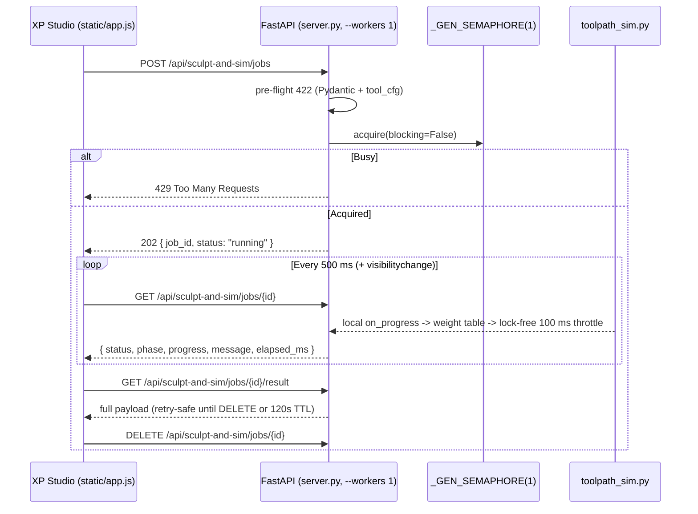

> [!NOTE]
> Technical architecture for `toolpath-loading-bar` (built on merged PR #3 XP Luna UI + PR #5 `safe-test.sh` runner).

## Context

`generate_synthetic_carve_path` takes ~246 s on `base_head` `demo` (`75%` in `build_finishing`, `12.8%` in `resample_path`, `11.4%` in `detect_gouges_detailed`, plus the post-gouge `feed_class` loop). Synchronous `POST /api/sculpt-and-sim` gives no progress feedback and risks proxy timeouts.

## System Architecture Diagram

## Technical Decisions

1. **Single-Process Memory Guard (`_GEN_SEMAPHORE = threading.Semaphore(1)`)**:
   - Protects **both** sync `POST /api/sculpt-and-sim` and async `POST /api/sculpt-and-sim/jobs` via non-blocking `acquire(blocking=False)` $\to$ `429` (never blocks FastAPI's threadpool). Prevents two concurrent ~3.3 GB peaks on the 12 GiB container.
   - **Single-worker `--workers 1` requirement**: `server.py` MUST run with `--workers 1`; with `--workers N`, polls land on other processes, return `404`, and each worker gets its own semaphore. CPython switches threads every `5 ms`, so `500 ms` polling stays responsive without `ProcessPoolExecutor` (which would double memory).
2. **Measured Weight Table, Throttling Outside Lock & Cooperative `JobCancelled`**:
   - Phase functions emit local `[0.0, 1.0]` progress (`resample_path` emits every `max(1, total // 20)` segments); `generate_synthetic_carve_path` maps via the single weight table (`0.01->0.02`, `0.02->0.77`, `0.77->0.90`, `0.90->0.91`, `0.91->0.97`, `0.97->0.98`). `server.py` emits `sculpt` (`0.00->0.01`) and `encode` (`0.98->1.00`).
   - `server.py`'s `on_progress` wrapper checks `cancel_event.is_set()` or `monotonic() - last_poll_at > 90.0` (raising `JobCancelled`), and checks `monotonic() - last_write >= 0.1` and `phase == last_phase` **before** acquiring `_JOBS_LOCK`.
   - Cancel latency: `DELETE` returns `202` `{ status: "cancelling" }`; `_GEN_SEMAPHORE` frees once the worker hits its next callback (`slices` loop, `resample_path` chunk, `detect_gouges_detailed` batch, or `feed_class` chunk), transitioning `status` to `"cancelled"` (retained up to `120 s` TTL).
3. **Deterministic Job Runner Seam (`_start_job_worker`)**:
   - `server.py` exposes `_start_job_worker(job_id: str, request: SimulationRequest) -> None` (default spawns a daemon `threading.Thread` running `_run_job`). Unit tests patch `_start_job_worker` to invoke `_run_job` inline deterministically (no sleeps/flaky threads).
4. **Split Status vs. Retry-Safe Result & Pre-Flight `tool_cfg` Validation**:
   - Pre-flight `tool_cfg.heated_length_mm > blade_length_mm` validation runs before `_GEN_SEMAPHORE` acquisition (immediate `422`, no overlay flash).
   - `GET /jobs/{id}` is tiny; `GET /jobs/{id}/result` returns `409` while active and is retry-safe when `done` until `DELETE /jobs/{id}` ack or `120 s` TTL (`_MAX_RETAINED_JOBS = 4` finished jobs only, FIFO by `completed_at`, never evicting `running`/`cancelling`).

## Risks / Trade-offs

- **[Risk] Server restart drops in-memory `_JOBS`** $\to$ Mitigation: `GET /jobs/{id}` returns `404`; `app.js` hides `#processing-overlay` and prompts retry.
- **[Risk] Browser tab backgrounded > 90 s** $\to$ Mitigation: `90 s` silence window + immediate `visibilitychange` poll + `pagehide` `fetch(url, { method: "DELETE", keepalive: true })`.
