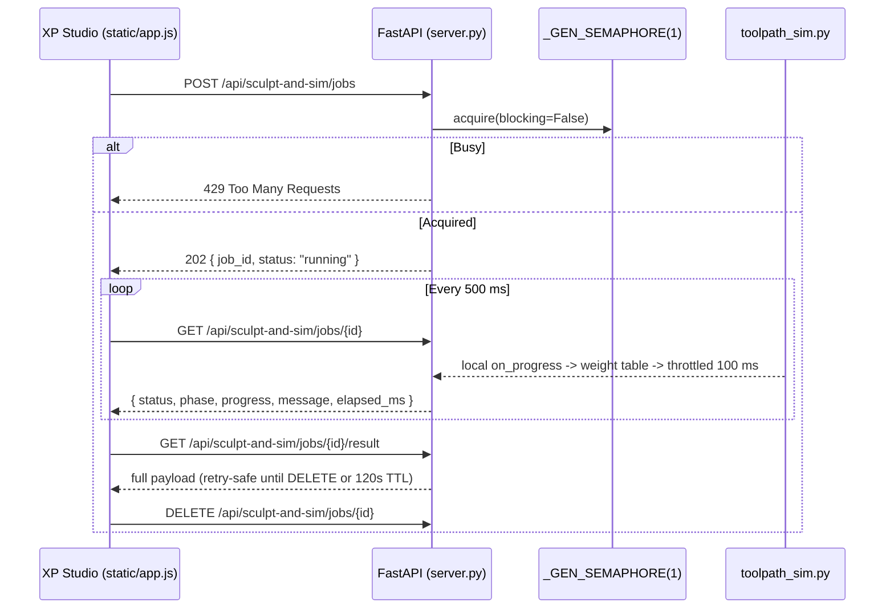

> [!NOTE]
> Technical architecture for `toolpath-loading-bar` (built on PR #3 XP Luna UI + PR #5 `safe-test.sh` runner).

## Context

`generate_synthetic_carve_path` takes 60–195 s (`75%` in `build_finishing`, `12.8%` in `resample_path`, `11.4%` in `detect_gouges_detailed`). Synchronous `POST /api/sculpt-and-sim` gives no progress feedback and risks proxy timeouts.

## System Architecture Diagram

## Technical Decisions

1. **Single-Process Memory Guard (`_GEN_SEMAPHORE = threading.Semaphore(1)`)**:
   - Protects **both** sync `POST /api/sculpt-and-sim` and async `POST /api/sculpt-and-sim/jobs` via non-blocking `acquire(blocking=False)` $\to$ `429`. Prevents two concurrent ~3.3 GB peaks on the 12 GiB container and prevents FastAPI threadpool starvation.
   - Single-worker `uvicorn` assumption is explicit. CPython switches threads every `5 ms`, so `500 ms` polling stays responsive without `ProcessPoolExecutor` (which would double memory).
2. **Measured Weight Table & Cooperative `JobCancelled`**:
   - Phase functions emit local `[0.0, 1.0]` progress; `generate_synthetic_carve_path` owns the single weight table (`0.01 / 0.75 / 0.13 / 0.01 / 0.08`, plus `0.98->1.00` for encoding).
   - `server.py` wraps `on_progress` with `100 ms` (or phase-change) throttling under `_JOBS_LOCK` and raises `JobCancelled` if `cancel_event.is_set()` or `last_poll_at` is stale (`> 15 s`).
3. **Split Status vs. Retry-Safe Result**:
   - `GET /jobs/{id}` is tiny; `GET /jobs/{id}/result` is retry-safe until `DELETE /jobs/{id}` ack or `120 s` TTL (`_MAX_RETAINED_JOBS = 4` finished jobs only).

## Risks / Trade-offs

- **[Risk] Server restart drops in-memory `_JOBS`** $\to$ Mitigation: `GET /jobs/{id}` returns `404`; `app.js` hides `#processing-overlay` and prompts retry.
- **[Risk] Browser tab backgrounded > 15 s triggers abandon-on-silence** $\to$ Mitigation: `15 s` threshold exceeds normal `500 ms`–`1 s` timer throttling; if triggered, `404`/cancelled state recovers cleanly.
