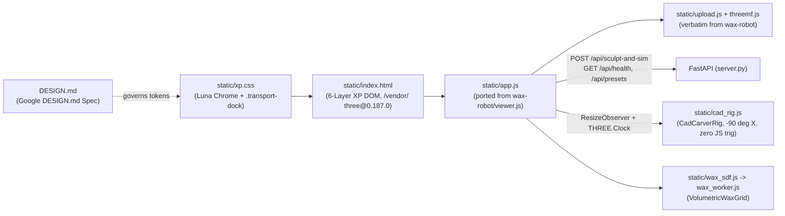

> [!NOTE]
> This document specifies **UI migration architecture only** (file seams, coordinate reconciliation, `ResizeObserver`, Google `DESIGN.md` compliance, and FastAPI static/health integration).

## Context

Migrates the Windows XP Luna Retro Minimalist UI from `wax-robot` (`/home/node/global-sandbox/projects/wax-robot`) into `carving-simulation` as **4-DOF Wax Carver Studio 2001**, formalized via Google's `DESIGN.md` spec (`github.com/google-labs-code/design.md`), strictly emoji-free, and wired to the merged `CadCarverRig` (`static/cad_rig.js`), `VolumetricWaxGrid` (`wax_worker.js`), and `server.py` (`/vendor/` `three@0.187.0` + `/api/sculpt-and-sim`).

## System Architecture Diagram

## Technical Decisions

### 1. Coordinate & Up-Axis Reconciliation (`wax-robot` vs. `CadCarverRig`)
- `wax-robot/static/viewer.js` sets `camera.up.set(0, 0, 1)`.
- `CadCarverRig` (`static/cad_rig.js`) and `VolumetricWaxGrid` live inside a `-90°` X-rotated root group with Three.js default `+Y` up (`camera.up.set(0, 1, 0)`).
- **Decision**: Retain `CadCarverRig`'s `+Y`-up camera + `-90°` X-rotated root group so `OrbitControls` and `static/models/*.glb` behave identically, while porting `wax-robot`'s `#f0ede0` background, `RoomEnvironment`, tone mapping, and 3-point lighting. Use `ResizeObserver` on `#viewport` so sidebar collapse and window maximize/minimize resize `WebGLRenderer` immediately.

### 2. Google `DESIGN.md` & Emoji-Free Enforcement
- Root `DESIGN.md` and `openspec/changes/xp-ui-overhaul/design.md` follow `github.com/google-labs-code/design.md` (YAML front matter with `{colors.*}` token references + the 8 ordered `##` sections).
- Unicode emojis are forbidden across HTML, CSS `content:`, and JS UI strings (enforced by `tests/test_xp_ui_lint.mjs`).

### 3. Transport Dock, CAD Controls & Pure Module Reuse (`upload.js`, `threemf.js`)
- `.transport-dock` is anchored inside `.inset-well.viewport-well` (`bottom: 8px; left: 8px; right: 8px; z-index: 10`), keeping the 3D canvas full-bleed inside the recessed well.
- `CadCarverRig` controls (`Machine Detail: Full / Tool Only` defaulting to `Tool Only` `< 900px`, `Unassigned Parts` note, `Provenance` `step_sha256` readout) and `BLADE_BROADSIDE_FEED` / `GLB_LOAD_FAILED` diagnostics are preserved inside the XP sidebar/status bar.
- `static/upload.js` and `static/threemf.js` are copied verbatim from `wax-robot/static/`.

### 4. FastAPI Static, `/vendor/` & Health Contract (`server.py`)
- Keep `server.py`'s `/vendor/` mount from `node_modules/three` (`three@0.187.0`).
- Port `wax-robot/web_app.py`'s `GET /api/health` fields (`max_upload_bytes`, `accepted_formats`) and `GET /api/presets` so `upload.js` and `#preset-select` / `Presets(P)` work seamlessly.
- Mount `StaticFiles(directory=STATIC_DIR, html=True)` at `/` after all `/api/*` and `/vendor` routes.

## Risks / Trade-offs

- **[Risk] Mixing `camera.up(0,0,1)` from `wax-robot` with `-90°` X-rotated `CadCarverRig` flips the scene** $\to$ Mitigation: Explicitly omit `camera.up.set(0, 0, 1)` in `static/app.js` and enforce via `tests/test_xp_ui_lint.mjs`.
- **[Risk] Emoji regression in button/icon copy** $\to$ Mitigation: `tests/test_xp_ui_lint.mjs` scans `static/index.html`, `static/xp.css`, and `static/app.js` for Unicode emoji ranges.
