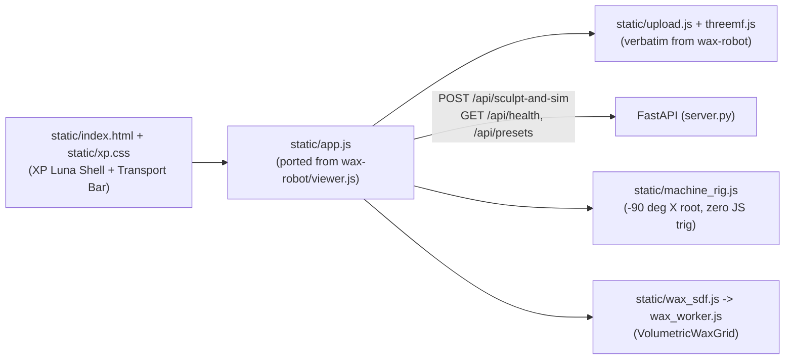

> [!NOTE]
> This document specifies **UI migration architecture only** (file seams, coordinate reconciliation, and FastAPI static/health integration).

## Context

Migrates the Windows XP Luna Retro Minimalist UI from `wax-robot` (`/home/node/global-sandbox/projects/wax-robot`) into `carving-simulation`, replacing the dark-mode UI draft in `carver-sim-mvp` while keeping all simulation/kinematics/SDF backend & Worker seams intact.

## System Architecture Diagram

## Technical Decisions

### 1. Coordinate & Up-Axis Reconciliation (`wax-robot` vs. `carver-sim-mvp`)
- `wax-robot/static/viewer.js` sets `camera.up.set(0, 0, 1)`.
- `carver-sim-mvp` keeps Three.js default `camera.up.set(0, 1, 0)` and mounts `PrimitiveCarverRig` + `VolumetricWaxGrid` inside a `-90°` X-rotated root group (`machine +Z -> Three.js +Y`).
- **Decision**: Retain `carver-sim-mvp`'s `+Y`-up camera + `-90°` X-rotated root group so `OrbitControls` and `PrimitiveCarverRig` behave identically, while porting `wax-robot`'s `#f0ede0` background, `RoomEnvironment`, tone mapping, and 3-point lighting.

### 2. Pure Module Reuse (`upload.js` & `threemf.js`)
- `static/upload.js` has zero DOM or Three.js dependencies and is copied verbatim from `wax-robot/static/upload.js`, tested directly via `node --test`.
- `static/threemf.js` is copied verbatim for client-side `.3mf` upload previews using the `three@0.160.0` `fflate` importmap.

### 3. FastAPI Static & Health Contract (`server.py`)
- Port `wax-robot/web_app.py`'s `GET /api/health` response fields (`max_upload_bytes`, `accepted_formats`) and `GET /api/presets` so `upload.js` and the `#preset-select` / `Presets(P)` menu work seamlessly.
- Mount `StaticFiles(directory=STATIC_DIR, html=True)` at `/` after all `/api/*` routes.

## Risks / Trade-offs

- **[Risk] Mixing `camera.up(0,0,1)` from `wax-robot` with `-90°` X-rotated rig flips the scene** $\to$ Mitigation: Explicitly omit `camera.up.set(0, 0, 1)` in `static/app.js` and add a lint/unit check.
